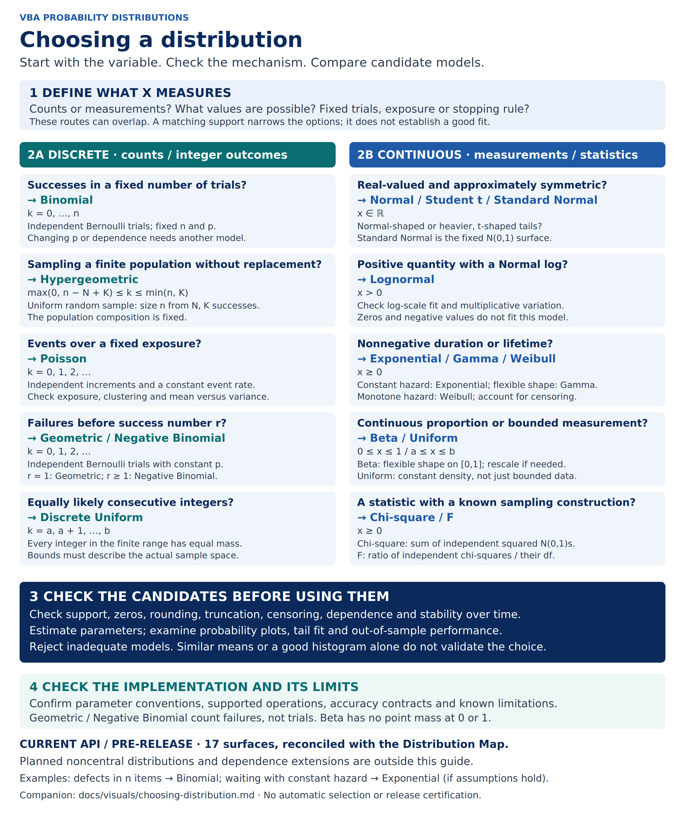

# Choosing a distribution



[Editable SVG](../../assets/choosing-distribution.svg) · [PNG](../../assets/choosing-distribution.png) · [Distribution Map](distribution-map.md) · [Probability functions](probability-functions.md)

**Caption:** Candidate models for successes, counts, waiting times and continuous
measurements. For example, successes in a fixed number of independent trials
with a common success probability suggest Binomial; a continuous waiting time
with constant hazard suggests Exponential. These routes overlap and are starting
points for assessment, not an automatic model-selection procedure.

## 1. Define the variable and observation process

Specify what one observation represents, its unit and possible values. Distinguish
fixed trial counts, fixed exposure and stopping at a success. Record rounding,
missing observations, truncation and censoring. A proportion calculated from a
finite count is discrete even when displayed as a percentage. A duration rounded
to days is not necessarily a count-generating process.

## 2. Identify candidate families

All names below match the implemented **pre-release** Distribution Map. Standard
Normal and Normal are two API surfaces of one mathematical family. Planned
noncentral distributions and dependence extensions are not implemented choices
in this guide. Supports refer to ordinary nondegenerate parameters; endpoint
densities may be singular. See the map for detailed parameter conventions.

| Observation / decision | Candidate | Support and assumptions to check |
| --- | --- | --- |
| Successes in n trials | Binomial | k = 0,…,n; fixed n, independent Bernoulli trials with common p. |
| Successes in a sample without replacement | Hypergeometric | max(0,n−N+K) ≤ k ≤ min(n,K); uniformly sampled n items from a fixed population of N with K successes. |
| Events over fixed exposure t | Poisson | Nonnegative integers; a homogeneous Poisson process has independent increments and constant rate λ, giving mean λt. Check exposure, event clustering and dispersion. |
| Failures before first success | Geometric | Nonnegative integers starting at zero; independent Bernoulli trials with constant p. |
| Failures before success number r | Negative Binomial | Nonnegative integers; fixed positive integer r, independent Bernoulli trials with constant p. r=1 recovers Geometric. |
| Equally likely consecutive integers | Discrete Uniform | Integers a,…,b, inclusive; equal probability for every allowed outcome. Use intended integer bounds rather than relying on input truncation. |
| Real-valued symmetric measurements | Normal / Student t | Real line; compare Normal shape with heavier t-shaped tails, and assess symmetry and tail behavior. Student t is also a sampling distribution under the appropriate construction. |
| Standard Normal variable | Standard Normal | Real line; specifically N(0,1). Standardizing arbitrary observations does not make them Normal. |
| Positive measurements whose logarithms are Normal | Lognormal | Strictly positive; check log-scale shape, zeros and multiplicative mechanism. |
| Waiting time with constant hazard | Exponential | Nonnegative; memorylessness and rate stability need support from the observation process. |
| Positive waiting times / skewed quantities | Gamma | Nonnegative; positive shape and scale. Integer shape gives the waiting time to that many events of a homogeneous Poisson process; a general Gamma fit does not require this interpretation. |
| Lifetimes with monotone hazard | Weibull | Nonnegative; shape below/at/above one gives decreasing/constant/increasing hazard. A bathtub-shaped hazard requires another model. |
| Continuous bounded proportions | Beta | [0,1], positive shape parameters; no point mass at either endpoint. Exact zeros/ones may reflect rounding or require a different observation/model specification. |
| Constant density over a finite interval | Uniform | [a,b]; boundedness alone is insufficient to justify equal density. |
| Sum of independent squared standard Normals | Chi-square | Nonnegative; the number of squared variables supplies integer degrees of freedom for this construction. |
| Ratio of independent chi-squares divided by their degrees of freedom | F | Nonnegative; independence and the stated scaling are essential to this construction. |

For Negative Binomial, overdispersed counts can also arise from a Poisson–Gamma
mixture; overdispersion alone does not establish that model. Check the
implementation's integer `NumberSuccesses` constraint before translating a fitted
count model to this API. Do not silently round a noninteger fitted shape.

Normal, Gamma, Weibull and Beta parameterizations are not interchangeable.
The implemented Student t surface takes degrees of freedom rather than separate
location and scale parameters; any transformation of measurements must be explicit
and its density Jacobian handled correctly. For a Beta transformation from [a,b]
to [0,1], probabilities and densities also require the appropriate transformation.
A Normal or t approximation can assign probability to physically impossible values;
check whether that is acceptable for the intended purpose.

## 3. Validate assumptions and fit

Estimate parameters with a method appropriate to the observation process,
including censoring where present. Compare empirical and fitted probabilities,
probability plots and tail behavior. Assess parameter uncertainty, stability,
dependence and performance on held-out observations where feasible. A goodness-of-fit
test may need adjustment when its parameters were estimated from the same sample.
A histogram or agreement of means alone is insufficient. If none of the candidates
is adequate, revise the model rather than forcing a choice from this catalogue.

The NIST/SEMATECH [probability-distributions overview](https://www.itl.nist.gov/div898/handbook/eda/section3/eda36.htm)
explains why distributional assumptions must be checked for the intended statistical
use. Its [distribution catalogue](https://www.itl.nist.gov/div898/handbook/eda/section3/eda366.htm)
provides mathematical background. These sources support modelling context, not
certification of this implementation.

## 4. Check the implementation

Use the [public API manifest](../PUBLIC_API.txt),
[accuracy contracts](../../benchmark/accuracy_contracts.csv) and
[known numerical limitations](../../benchmark/numerical_limitations.csv).
Mathematical support is not a numerical accuracy guarantee over the full parameter
space. This guide adds no fitting algorithm, VBA function or Excel certification.

## Regeneration and provenance

Original project-authored layout and explanatory text. The
[generator](generate_choosing_distribution.py) shares the Distribution Map inventory
and validates all 17 API surfaces against the public manifest before generating
editable SVG text. There are no mathematical curves, external data or AI-rendered
mathematical elements. Baseline: `c8917cb5afb9546379a33a35781c538ed3f70430`.

```sh
python -m pip install CairoSVG==2.8.2
python docs/visuals/generate_choosing_distribution.py --png
python docs/visuals/generate_choosing_distribution.py --check --png
```

Use Cairo and DejaVu Sans system dependencies. The PNG is rendered directly from
the SVG at 2800 × 3320. Byte comparison assumes the same Cairo/font environment;
review renderer-dependent differences before replacing the image. `--check`
without `--png` validates the SVG and API inventory without CairoSVG.

## Integration handoff

- **README:** link below the Distribution Map to this decision guide.
- **Wiki:** publish as “Choosing a distribution”; add a navigation link after
  Probability functions. Use immutable reviewed commit URLs for the PNG, SVG and
  this companion. Include the accessible table, caption and caveats as text.
- **Initial manual (#263):** optional “Choosing a model” section after the
  distribution overview, if the reviewed asset is available before manual freeze.
  Initial manual delivery remains independent of this visual.
- **Manual update (#264):** include the figure and accessible table after the
  overview, before parameter and worksheet examples; reconcile against that release.
- **Demo overview (#254):** use these names and observation conventions in the
  scenario descriptions; model choice and fit remain separate from function demos.

At 170 mm print width, use the figure on a dedicated page and retain the table as
searchable text. On mobile, use the accessible table or zoom the SVG.
