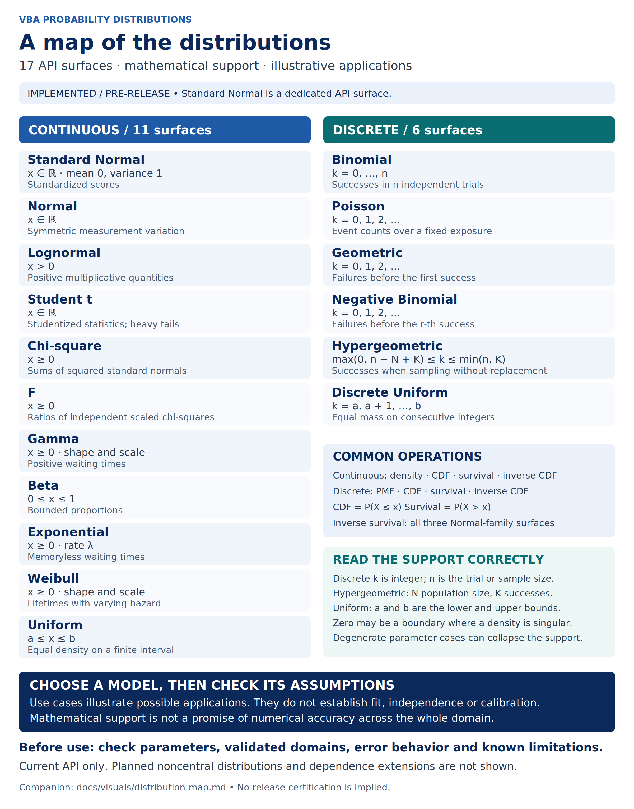

# Distribution map



[Editable SVG](../../assets/distribution-map.svg) · [PNG](../../assets/distribution-map.png) · [README catalogue](../../README.md#-distribution-catalogue)

The map describes the **implemented pre-release API**, not a published v1.0.1
release. Standard Normal and Normal are separate API surfaces of the same
mathematical family. Planned noncentral distributions and dependence extensions
are deliberately absent. The detailed catalogue remains authoritative for
additional helpers, moments and parameter conversions.

## Accessible content

Supports below describe ordinary nondegenerate parameter cases. They describe
where the random variable can lie, not every parameter/input the implementation
accepts. Endpoint density values may be singular; degenerate parameter cases
can collapse the support. See the [numerical limitations](../../benchmark/numerical_limitations.csv)
and [accuracy contracts](../../benchmark/accuracy_contracts.csv) before use.

| Class | API surface | Mathematical support | Illustrative use |
| --- | --- | --- | --- |
| Continuous | Standard Normal (`NormalStandard`) | x ∈ ℝ  ·  mean 0, variance 1 | Standardized scores |
| Continuous | Normal (`Normal`) | x ∈ ℝ | Symmetric measurement variation |
| Continuous | Lognormal (`Lognormal`) | x > 0 | Positive multiplicative quantities |
| Continuous | Student t (`StudentT`) | x ∈ ℝ | Studentized statistics; heavy tails |
| Continuous | Chi-square (`ChiSquare`) | x ≥ 0 | Sums of squared standard normals |
| Continuous | F (`F`) | x ≥ 0 | Ratios of independent scaled chi-squares |
| Continuous | Gamma (`Gamma`) | x ≥ 0  ·  shape and scale | Positive waiting times |
| Continuous | Beta (`Beta`) | 0 ≤ x ≤ 1 | Bounded proportions |
| Continuous | Exponential (`Exponential`) | x ≥ 0  ·  rate λ | Memoryless waiting times |
| Continuous | Weibull (`Weibull`) | x ≥ 0  ·  shape and scale | Lifetimes with varying hazard |
| Continuous | Uniform (`Uniform`) | a ≤ x ≤ b | Equal density on a finite interval |
| Discrete | Binomial (`Binomial`) | k = 0, …, n | Successes in n independent trials |
| Discrete | Poisson (`Poisson`) | k = 0, 1, 2, … | Event counts over a fixed exposure |
| Discrete | Geometric (`Geometric`) | k = 0, 1, 2, … | Failures before the first success |
| Discrete | Negative Binomial (`NegativeBinomial`) | k = 0, 1, 2, … | Failures before the r-th success |
| Discrete | Hypergeometric (`Hypergeometric`) | max(0, n − N + K) ≤ k ≤ min(n, K) | Successes when sampling without replacement |
| Discrete | Discrete Uniform (`DiscreteUniform`) | k = a, a + 1, …, b | Equal mass on consecutive integers |

Here ℝ denotes the real line. For discrete variables, k is an integer. In the
hypergeometric row, N is PopulationSize, K is PopulationSuccesses and n is
SampleSize; in the binomial row n is Trials. The negative-binomial r is
NumberSuccesses. Both geometric and negative-binomial variables count
**failures**, starting at zero. Discrete Uniform uses the implementation's
truncated bounds as a and b. Continuous Uniform uses its real bounds.

Every continuous surface offers density, cumulative, survival and inverse
cumulative operations. Every discrete surface offers PMF, cumulative, survival
and inverse cumulative operations. CDF means P(X ≤ x); survival means P(X > x).
Direct inverse survival is implemented for Standard Normal, Normal and
Lognormal only. Consult the [public API](../PUBLIC_API.txt) for exact signatures
and the [README catalogue](../../README.md#-distribution-catalogue) for all
additional operations. Examples suggest applications; they do not validate
model fit, independence, calibration or distributional assumptions.

## Regeneration and review

The [generator](generate_distribution_map.py) contains the text and layout as
editable source and verifies the family inventory, four common operations and
inverse-survival scope against `docs/PUBLIC_API.txt`. It fails on inventory drift.
The SVG retains editable text, accessible title/description and explicit colors;
there are no raster illustrations, external fonts, data dependencies or AI-drawn
mathematical curves. The PNG is rendered directly from that SVG at 2400 × 3060.

From the repository root, in a disposable Python environment:

```sh
python -m pip install CairoSVG==2.8.2
python docs/visuals/generate_distribution_map.py --png
python docs/visuals/generate_distribution_map.py --check --png
```

Install the system Cairo library and DejaVu Sans fonts first if unavailable.
The delivery render uses CairoSVG 2.8.2 and DejaVu Sans on Linux. PNG byte identity
is checked within that rendering environment; other Cairo/font versions may
rasterize text differently. Review such differences before committing a new PNG.
Without CairoSVG, `--check` still validates API coverage and SVG currency.
Keep the SVG and PNG in `assets/`, the repository's approved image directory.

Provenance: original project-authored typography/layout and explanatory text,
reconciled with the README catalogue, public API manifest and the parameter/support
comments in the four distribution-family modules. Baseline inspected:
`f2ff901b17855a362e4ba447df05637d4d2f0cd3` on `release/1.0.0`.
The navy/blue palette and rounded information panels follow the portfolio's
existing visual language. No external artwork or third-party data is embedded.

## Integration handoff

- **README:** immediately below Distribution catalogue, before detailed tables.
- **Initial manual (#263):** optional insertion in the opening distribution
  overview if the reviewed asset is available before manual freeze; the manual
  must remain deliverable independently of this v1.0.1 issue.
- **Manual update (#264):** include the approved map in the opening overview,
  followed by parameter conventions and validated-domain links. Reconcile the
  inventory against the actual release candidate before publication.
- **Demo overview (#254):** use the same family names and failures-before-success
  convention; this image is a coordination reference, not a workbook prerequisite.

For a portrait PDF page, use the full-page figure at approximately 170 mm width;
retain the accessible table as searchable text. In a narrow/mobile view, use the
SVG's zoomable version or the table rather than compressing the image further.

Suggested caption: “Implemented probability-distribution API surfaces, their
mathematical supports and illustrative applications. Numerical validity is
restricted to the documented parameter domains and accuracy contracts.”
