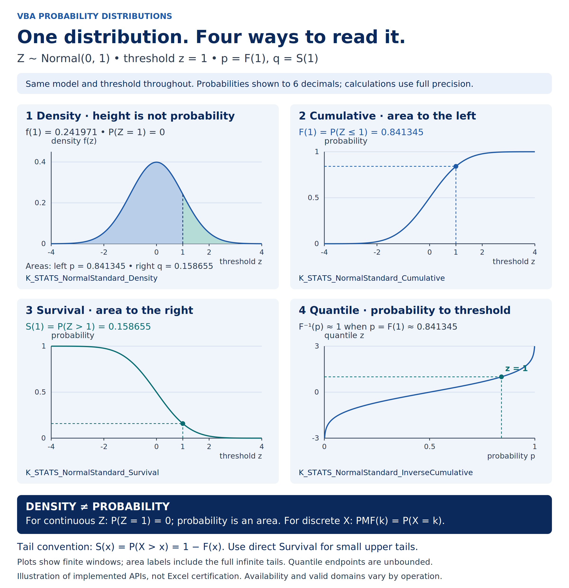

# Density, cumulative, survival and quantile



[Editable SVG](../../assets/probability-functions.svg) · [PNG](../../assets/probability-functions.png) · [Distribution map](distribution-map.md) · [Public API](../PUBLIC_API.txt)

**One example throughout:** Z is Standard Normal (mean 0, standard deviation 1),
with threshold z = 1. The same p = F(1) and q = S(1) appear in every panel.
Labels are rounded for readability; calculations use full precision.

## Accessible explanation

| Panel | Quantity | Interpretation at z = 1 | Mathematical reference (rounded) |
| --- | --- | --- | --- |
| Density | f(z) | Curve height, not the probability of observing exactly 1 | 0.241970724519143 |
| Cumulative | F(z) = P(Z ≤ z) | Blue area under the density to the left of 1 | 0.841344746068543 |
| Survival | S(z) = P(Z > z) | Teal area under the density to the right of 1 | 0.158655253931457 |
| Quantile | F⁻¹(p) | Threshold whose cumulative probability is p; for p = F(1), the threshold is 1 | approximately 1 with binary64 arithmetic |

The PDF integrates to one over the real line. Its height has units reciprocal to
the variable's units and can exceed one for other continuous distributions or
scales. A single point has zero probability: P(Z = 1) = 0. Interval probability
is an **area under the density**, not an area under the CDF or survival curve.
The latter two panels plot probability as their vertical coordinate.

For a discrete variable, the **PMF** at integer k is P(X = k), an actual point
probability. The strict upper-tail convention remains S(x) = P(X > x), so
F(x) + S(x) = 1. In the discrete case, P(X ≥ k) generally differs from S(k);
for integer-valued X it equals S(k − 1). For a continuous distribution the
probability of equality is zero.

The CDF and quantile panels reverse the same relationship: threshold →
probability and probability → threshold. For the strictly increasing Normal CDF,
F⁻¹(F(z)) = z mathematically. A discrete quantile instead uses the generalized
inverse (smallest supported k with F(k) ≥ p for interior probabilities); its
round trip need not be equality.

The first three panels show z from −4 to 4. The quantile panel shows the portion
with outputs from −3 to 3. These are finite **display windows**, not support or
validated numerical-domain restrictions. Shaded areas are visually truncated at
the plot boundary; their labels include the full infinite tails. Mathematical
Normal quantiles tend to −∞ and +∞ as p tends to 0 and 1; consult the API's error
contract before passing endpoints to a worksheet function.

## Worksheet and VBA mapping

The illustration uses these implemented functions. Enter the following in a
workbook importing the production modules described in [installation](../../INSTALLATION.md).
The displayed values below are independently calculated mathematical references;
they are not a new Excel execution or certification record.

| Cell | Formula | Meaning |
| --- | --- | --- |
| B2 | `=1` | Common z threshold |
| B3 | `=K_STATS_NormalStandard_Density(B2)` | PDF height |
| B4 | `=K_STATS_NormalStandard_Cumulative(B2)` | Full-precision p used for inversion |
| B5 | `=K_STATS_NormalStandard_Survival(B2)` | Direct upper-tail probability q |
| B6 | `=K_STATS_NormalStandard_InverseCumulative(B4)` | Recovered threshold, approximately 1 |

Use B4 directly in B6, **not** the rounded label 0.841345. Worksheet formatting
can display six decimals without rounding the stored probability. In VBA the
same functions take one required Double argument and an optional ByRef String
status argument, returning Variant; retain documented worksheet-error handling.

Survival is mathematically 1 − F, but subtracting a rounded CDF from one can lose
small upper-tail probabilities. Call `Survival` directly. Direct inverse
survival is also available for Standard Normal, Normal and Lognormal; this
figure does not imply it is available for every distribution. Reconcile exact
signatures and operation availability with [PUBLIC_API.txt](../PUBLIC_API.txt).

These are implemented pre-release APIs. The figure does not certify numerical
accuracy across their domains. See the [accuracy contracts](../../benchmark/accuracy_contracts.csv)
and [known numerical limitations](../../benchmark/numerical_limitations.csv).

## Reproduce and verify

The [generator](generate_probability_functions.py) creates editable SVG text and
vector paths. PDF values use `exp(-z*z/2)/sqrt(2*pi)`; CDF/SF use opposite erfc
arguments, computing the upper tail directly. Quantiles use Python's
`statistics.NormalDist.inv_cdf`. Curves are calculated, not drawn by an image
model. The four NormalStandard names are checked against the public API manifest.

From the repository root in a disposable Python environment:

```sh
python -m pip install CairoSVG==2.8.2 mpmath==1.3.0
python docs/visuals/generate_probability_functions.py --png --verify-reference
python docs/visuals/generate_probability_functions.py --check --png --verify-reference
```

The independent verification uses mpmath at 80 decimal digits: quadrature for
both probability-area annotations, analytic PDF/erfc references for all 801
samples per forward curve, and erfinv for 602 quantile checks including the
highlighted threshold. Inputs are the exact plotted binary64 values. Tolerances
are absolute 2e-16 for area annotations, 3e-16 for forward samples and 3e-15 for
quantiles. These are illustration-generation checks, not changes to the VBA
accuracy contracts. Failure stops generation/checking with a nonzero exit.

The SVG is 1200 × 1240; its matching PNG is rendered directly at 2400 × 2480.
The delivery render uses CairoSVG 2.8.2, system Cairo and DejaVu Sans on Linux.
Install Cairo/DejaVu Sans if missing. `--check --png` requires byte identity in
that environment; different font/Cairo versions can produce different text
rasterization and require visual review. Without optional dependencies,
`--check` verifies SVG currency and API mapping using the standard library.

Provenance: original project-authored layout and explanatory prose, standard
Normal formulas and synthetic inputs. No external artwork or third-party data
is embedded. API/source inspection baseline:
`1ae078d0cbd8e7008d0b2f5fd67767ee328ad6c8` on `release/1.0.0`.

## Integration and reuse

- **README:** visual-learning link in Quick start, before the first worksheet example.
- **Wiki:** use this guide's accessible explanation and worksheet table in a
  “Probability functions” page, linked from the wiki home/usage page. Embed the
  PNG via the repository's raw URL at the reviewed delivery commit, and link the
  SVG and this companion at the same commit. Publish those links only after the
  delivery PR is merged; a branch preview is not a published release guide.
- **Demo worksheets:** reproduce B2:B6 with ordinary cell references, six-decimal
  display formatting and the original stored p. Place the visual in the
  probability-functions lesson within the approved Ribbon/vertical-navigation
  template. The image does not itself deliver a demo workbook or its UI.
- **User manual:** optional reusable figure for probability/tail/quantile
  conventions in #263; drafting that initial manual must not depend on this
  v1.0.1 asset. Reconcile it again for the release-stage update #264.

At narrow/mobile widths, use the accessible table or zoomable SVG. Suggested
caption: “The same Standard Normal threshold read as density height, left-tail
probability, right-tail probability and inverse cumulative probability. Shading
represents areas under the PDF; plotted probabilities use the full tails.”
